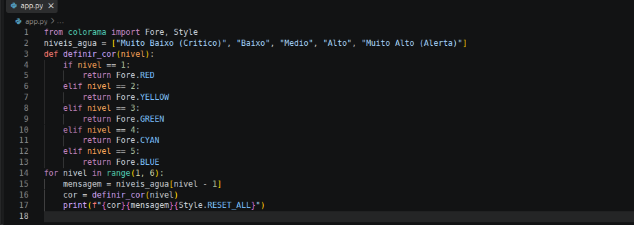
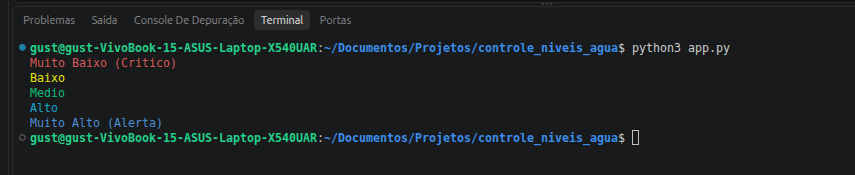

# 💧 Controle de Níveis de Água

Projeto desenvolvido em Python para simular o monitoramento dos níveis de água de um reservatório, exibindo mensagens de alerta coloridas no terminal com o auxílio da biblioteca Colorama.

## 🎯 Objetivo

O objetivo deste projeto é praticar conceitos fundamentais da programação, como listas, funções, estruturas condicionais, laços de repetição e utilização de bibliotecas externas.

## ⚙️ Funcionalidades

- Armazena cinco níveis de água em uma lista.
- Associa cada nível a uma cor específica.
- Exibe mensagens de alerta coloridas no terminal.
- Restaura o estilo padrão do terminal após cada mensagem.

## 🎨 Níveis do reservatório

| Nível | Situação | Cor |
|:---:|---|---|
| 1 | Muito baixo (crítico) | Vermelho |
| 2 | Baixo | Amarelo |
| 3 | Médio | Verde |
| 4 | Alto | Ciano |
| 5 | Muito alto (alerta) | Azul |

## 🛠️ Tecnologias utilizadas

- **Python 3:** linguagem de programação utilizada no projeto.
- **Colorama:** biblioteca utilizada para aplicar cores às mensagens exibidas no terminal.

## 📦 Instalação

1. Certifique-se de ter o Python 3 instalado.
2. Abra o terminal na pasta do projeto.
3. Instale a biblioteca Colorama com o comando:

```bash
python3 -m pip install colorama
```

## ▶️ Como executar

No terminal, dentro da pasta do projeto, execute:

```bash
python3 app.py
```

O programa percorrerá os cinco níveis definidos no código e exibirá as respectivas mensagens com suas cores.

## 📸 Código-fonte

Abaixo está a captura de tela do código desenvolvido no arquivo `app.py`.



## 💻 Execução do programa

A imagem abaixo demonstra a execução do programa no terminal, com os cinco níveis de água e suas respectivas cores.



## 📚 Aprendizados

Este projeto permitiu praticar a criação de listas, a definição de funções, o uso de estruturas condicionais e laços de repetição, além da importação de bibliotecas externas e da formatação de mensagens no terminal.

---

Desenvolvido como atividade prática do curso de Desenvolvimento de Sistemas.

